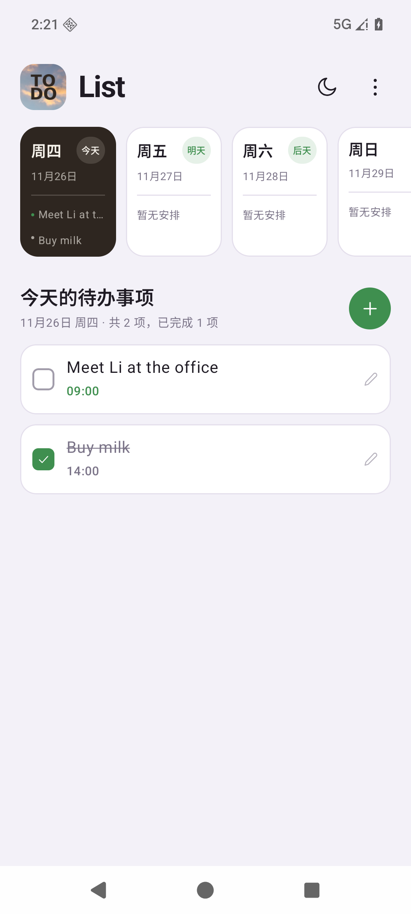
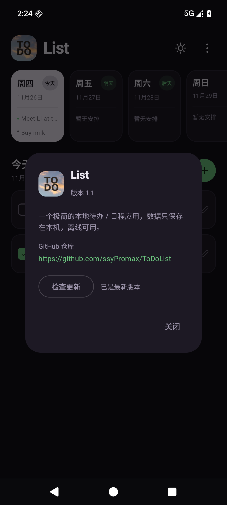
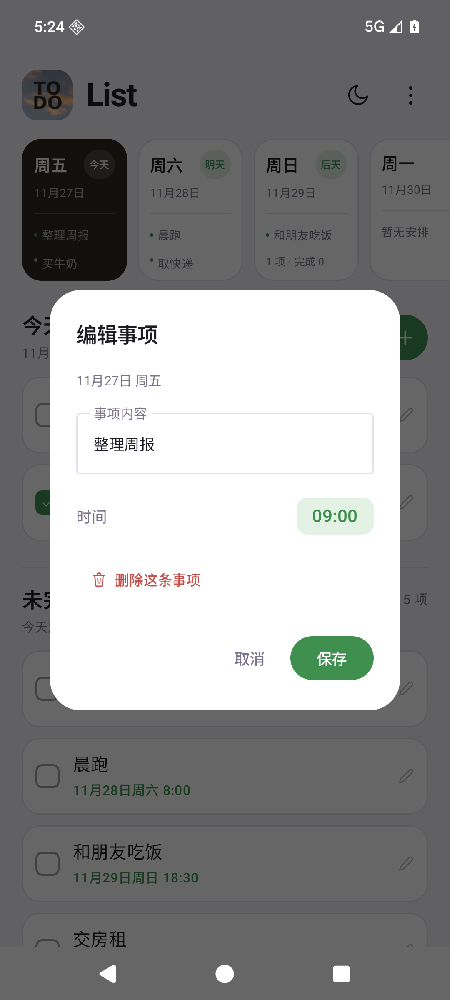
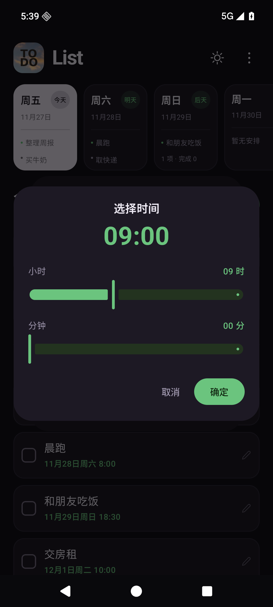

# List

一个极简的安卓待办 / 日程 App：上面是今天起 7 天的日程卡片，下面是当天的事项清单。支持深浅色切换、按时间排序、勾选划掉、点按修改/删除/改时间，数据本地持久化，离线可用。

仓库地址：<https://github.com/ssyPromax/ToDoList>

| 浅色 | 深色 |
| --- | --- |
|  |  |

## 功能

**1. 顶部栏**
- 左侧是应用图标 + 名字 `List`；
- 右侧是主题开关（浅色显示月亮 🌙，深色显示太阳 ☀️），点击即时切换并记住选择（未手动切换时跟随系统深色模式）；
- 最右侧是三点菜单：**历史日程**、**关于**。

**2. 今天 + 后六天的日程**
- 一排横向滑动的方块卡片，每张写清**星期**（周四）和**几月几号**（11月26日），今天/明天/后天用右上角小胶囊额外标注；卡片内还有当天事项预览（最多两条 + 剩余条数）和「N 项 · 完成 M」统计；
- 选中的卡片以反色高亮；滑动不会挤占下方空间；
- 点击任意卡片，下方清单立刻切换到那天的事项。

**3. 当天待办事项**
- 每项前有勾选框，勾选后整条变灰并加删除线；
- 点击事项可打开编辑弹窗：改文字、改具体时间（小时/分钟，Material3 表盘选择器）、删除整条；
- 列表严格按时间升序排列；
- 右上角绿色 `+` 按钮新建事项，默认时间取「下一个整点」，也总是添加到当前选中的那一天；
- 空列表有占位提示。

**4. 历史日程**
- 三点菜单 → 历史日程，按日期从新到旧归档所有早于今天的安排；
- 每个日期带「周X + 几月几号」和当天条数，条目显示时间与完成状态（完成的带删除线）；
- 顶部返回按钮/系统返回键均可回到主界面。

**5. 关于 / 检查更新**
- 三点菜单 → 关于：应用图标、版本号、简介、**GitHub 仓库地址**（可点击跳转浏览器）；
- **检查更新**按钮会读取 GitHub Releases 上最新的 release 版本号：一致时提示「已是最新版本」，有新版时显示版本号并给出「前往下载新版本」入口，网络异常/无发布时给出对应提示。

**6. 数据**
- 使用 `SharedPreferences + JSON` 本地保存，不联网（只有「检查更新」会访问 GitHub API），无敏感权限，进程被杀后数据仍在。

## 截图

| 三点菜单 | 历史日程 | 关于 |
| --- | --- | --- |
|  |  |  |

| 检查更新 · 已是最新 | 检查更新 · 发现新版本 |
| --- | --- |
|  |  |

| 编辑事项 | 时间选择（浅色） | 时间选择（深色） |
| --- | --- | --- |
|  |  |  |

启动器图标（`TO / DO`，天空照片 + 1/128 虚化 + 5% 白蒙版，字色 `#2E2620`）：


## 应用图标

由 `photo-wash-icon` 技能生成：

```bash
python make_icons.py \
  --background tools/assets/background.jpg \
  --res app/src/main/res \
  --line1 TO --line2 DO \
  --blur-div 128 --mask-alpha 13 \
  --preview tools/assets/icon_preview_512.png
```

产出 `mipmap-mdpi/hdpi/xhdpi/xxhdpi/xxxhdpi/ic_launcher.png`（48/72/96/144/192 px）。界面顶栏图标与启动器图标共用同一个 `@mipmap/ic_launcher` 资源。原始照片只保留在本地 `tools/assets/`（未提交仓库），仓库里只有生成后的图标。

## 技术栈

| 项 | 值 |
| --- | --- |
| 语言 / UI | Kotlin 2.4.21 + Jetpack Compose（Material 3） |
| 构建 | AGP 9.5.3 / Gradle 9.6.0 / JDK 17 字节码 |
| SDK | compileSdk 37.2、targetSdk 37、minSdk 26（Android 8.0+） |
| 依赖 | Compose BOM 2026.11.01 + activity-compose + core-ktx（无第三方网络库） |
| 版本 | versionCode 2 / versionName 1.1 |

## 目录结构

```
app/src/main/java/com/dswork/list/
├── MainActivity.kt          # 入口、主题状态、系统栏配色、主界面/历史页切换
├── data/
│   ├── Todo.kt              # 数据模型 + 中文日期文案
│   ├── TodoStore.kt         # SharedPreferences JSON 持久化
│   └── UpdateChecker.kt     # GitHub Releases 版本检查（HttpURLConnection）
└── ui/
    ├── HomeScreen.kt        # 顶栏 / 三点菜单 / 日期卡片 / 事项列表 / 编辑弹窗 / 时间选择器
    ├── HistoryScreen.kt     # 历史日程
    ├── AboutDialog.kt       # 关于 + 检查更新
    └── theme/Theme.kt       # 深浅两套配色
app/src/main/res/
├── drawable/                # 月亮、太阳、三点、返回、加号、勾、删除、编辑等细线矢量图标
└── mipmap-*/                # 生成的启动器图标
screenshots/                 # 模拟器实拍截图
```

## 构建 / 安装

```bash
# 需要 Android SDK（platform-tools + platform android-37.2 + build-tools 36）
export ANDROID_HOME=~/Android/Sdk        # 或写进 local.properties
./gradlew :app:assembleDebug
adb install -r app/build/outputs/apk/debug/app-debug.apk
```

APK 见 [Releases](https://github.com/ssyPromax/ToDoList/releases)。

## 已验证（Android 16 / API 36 模拟器，1080×2400）

- 启动、深浅色切换、状态栏图标颜色跟随主题；
- 7 天卡片横向滑动、跨月日期（11/30 → 12/1）正确、点击切换日期；
- 新建 / 编辑 / 删除事项，改时间后自动重新排序；
- 勾选后划掉并更新「已完成」计数；重启进程后数据、主题均保留；
- 三点菜单、历史日程（过去的安排按日期归档）、关于页与检查更新（GitHub API 返回「无发布 / 已是最新 / 有新版」三种状态均验证）；
- 启动器与应用抽屉中的 List 图标正确显示。
