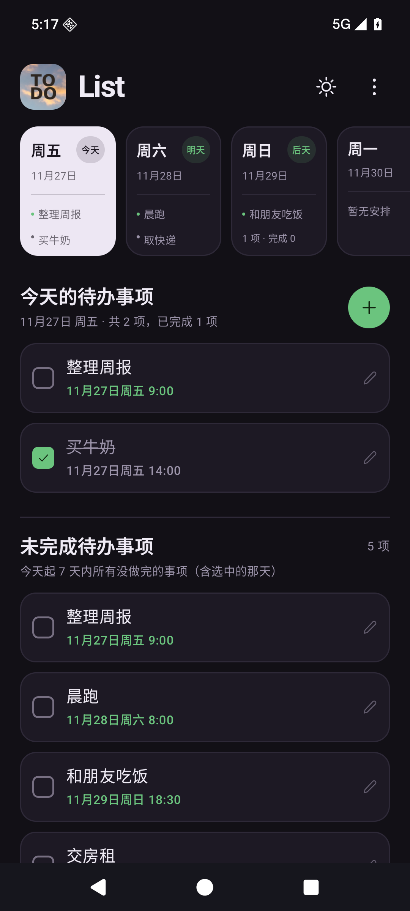
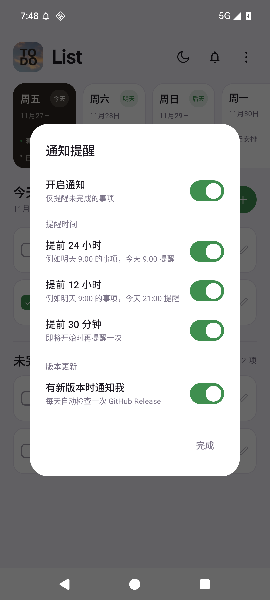
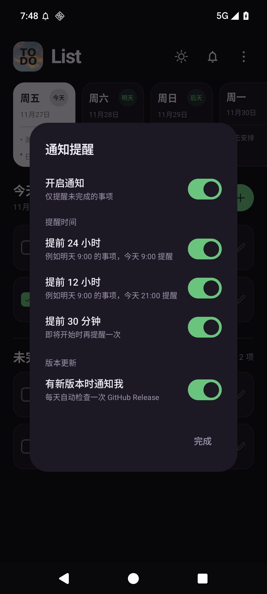
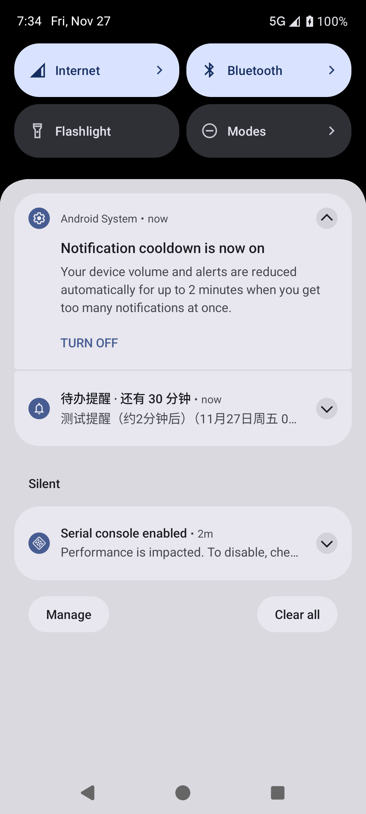
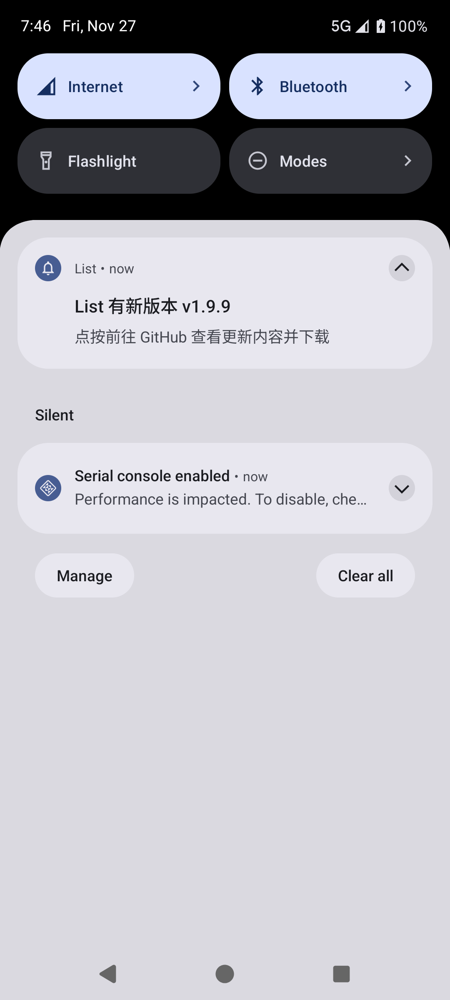
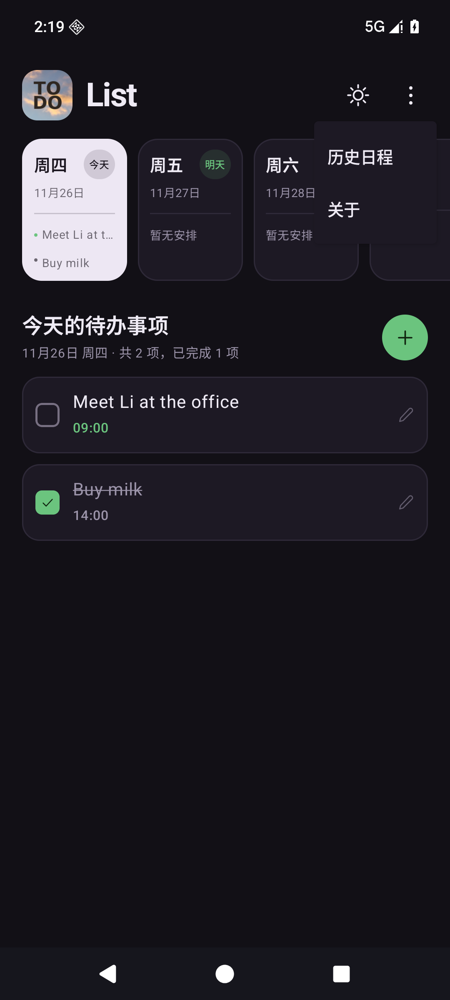
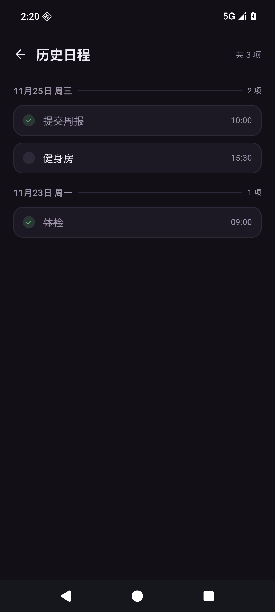
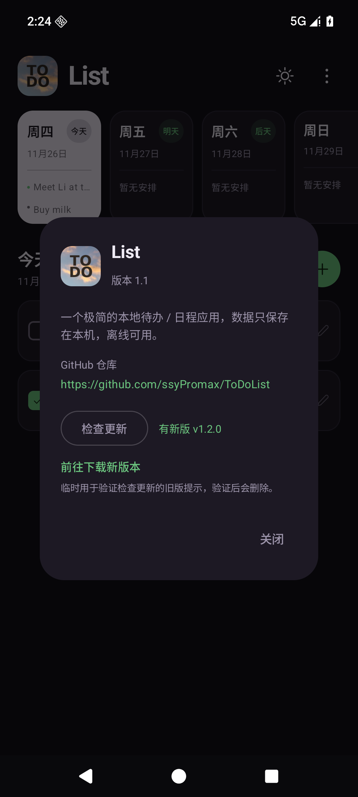
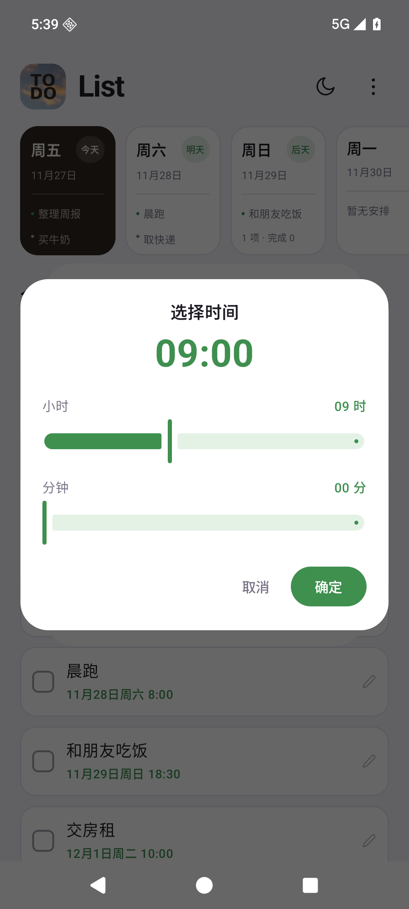

# List

一个极简的安卓待办 / 日程 App：上面是今天起 7 天的日程卡片，下面是当天的事项清单。支持深浅色切换、按时间排序、勾选划掉、点按修改/删除/改时间，数据本地持久化，离线可用。

仓库地址：<https://github.com/ssyPromax/ToDoList>

| 浅色 | 深色 |
| --- | --- |
|  |  |

## 功能

**1. 顶部栏**
- 左侧是应用图标 + 名字 `List`；
- 右侧依次是：主题开关（浅色显示月亮 🌙，深色显示太阳 ☀️）、**通知提醒**铃铛、三点菜单（**历史日程**、**关于**）；主题切换即时生效并记住选择（未手动切换时跟随系统深色模式）。

**2. 今天 + 后六天的日程**
- 一排横向滑动的方块卡片，每张写清**星期**（周四）和**几月几号**（11月26日），今天/明天/后天用右上角小胶囊额外标注；卡片内还有当天事项预览（最多两条 + 剩余条数）和「N 项 · 完成 M」统计；
- 整页是**同一个纵向滚动容器**：日期卡片、当天清单、未完成汇总一起滚动，向下翻时卡片会跟着收起；卡片行内的左右滑动仍然独立；
- 选中的卡片以反色高亮，选中后卡片行会自动把该卡片滚到可见位置；
- 点击任意卡片，下方清单立刻切换到那天的事项。

**3. 当天待办事项**
- 每项前有勾选框，勾选后整条变灰并加删除线；
- 每条事项都带**完整时间信息**：`11月28日周六 8:00`（几月几号 + 星期 + 小时分钟），跨天也一眼看清；
- 点击事项可打开编辑弹窗：改文字、改具体时间（**小时 / 分钟两条滑动条**，带大号时间预览）、删除整条；
- 列表严格按时间升序排列；
- 右上角绿色 `+` 按钮新建事项，默认时间取「下一个整点」，也总是添加到当前选中的那一天；
- 空列表有占位提示。

**4. 未完成待办事项（汇总）**
- 选中日期的清单下方固定有「未完成待办事项」分区，汇总**今天起 7 天内所有未完成**的事项（含选中那天），按日期 + 时间排序，并显示总条数；
- 直接在汇总区勾选即可完成，条目会立刻从汇总中移除、源日期里的状态同步更新；
- 全部做完时显示「这几天没有未完成的事项」。

**5. 历史日程**
- 三点菜单 → 历史日程，按日期从新到旧归档所有早于今天的安排；
- 每个日期带「周X + 几月几号」和当天条数，条目显示时间与完成状态（完成的带删除线）；
- 顶部返回按钮/系统返回键均可回到主界面。

**6. 通知提醒**
- 顶栏铃铛 → 通知提醒设置：一个总开关 + 「提前 24 小时 / 提前 12 小时 / 提前 30 分钟」三个开关；
- 只对**未完成**的事项发送；在截止时间的对应提前量各提醒一次，通知内容包含事项标题和「几月几号 周X 时间」；
- 打开总开关时按需申请 Android 13+ 通知权限；没有精确闹钟权限时会退化为普通闹钟（±10 分钟窗口）；
- 事项增删改、勾选完成、删除后立即重排所有提醒；重启手机后由 `BOOT_COMPLETED` 自动恢复。

**7. 版本更新推送**
- App 启动时以及每天一次的后台检查会读取 GitHub Release 最新版本（12 小时节流，同一个版本只提醒一次）；
- 发现新版本时推送通知「List 有新版本 vX.Y.Z」，点按直接打开 Release 页面下载；
- 可在「通知提醒 → 版本更新」里单独关闭（默认开启），与待办提醒总开关互不影响。

**8. 关于 / 检查更新**
- 三点菜单 → 关于：应用图标、版本号、简介、**GitHub 仓库地址**（可点击跳转浏览器）；
- **检查更新**按钮会读取 GitHub Releases 上最新的 release 版本号：一致时提示「已是最新版本」，有新版时显示版本号并给出「前往下载新版本」入口，网络异常/无发布时给出对应提示；
- 版本检查优先走 `releases/latest` 的网页重定向（不消耗 GitHub API 限额），失败再回退到 REST API，避免匿名 60 次/小时限流导致误报。

**9. 数据**
- 使用 `SharedPreferences + JSON` 本地保存，不联网（只有「检查更新」会访问 GitHub API），进程被杀后数据仍在；
- 通知提醒完全本地（AlarmManager + 通知渠道），除系统通知/重启权限外不申请敏感权限。

## 截图

| 通知提醒设置（浅色） | 通知提醒设置（深色） | 到点提醒 |
| --- | --- | --- |
|  |  |  |

| 版本更新推送 |
| --- |
|  |

| 三点菜单 | 历史日程 | 关于 |
| --- | --- | --- |
|  |  |  |

| 检查更新 · 已是最新 | 检查更新 · 发现新版本 |
| --- | --- |
|  |  |

| 编辑事项 | 时间选择（浅色） | 时间选择（深色） |
| --- | --- | --- |
|  |  |  |

启动器图标（`TO / DO`，天空照片 + 1/128 虚化 + 5% 白蒙版，字色 `#2E2620`）：


## 应用图标

由 `photo-wash-icon` 技能生成：

```bash
python make_icons.py \
  --background tools/assets/background.jpg \
  --res app/src/main/res \
  --line1 TO --line2 DO \
  --blur-div 128 --mask-alpha 13 \
  --preview tools/assets/icon_preview_512.png
```

产出 `mipmap-mdpi/hdpi/xhdpi/xxhdpi/xxxhdpi/ic_launcher.png`（48/72/96/144/192 px）。界面顶栏图标与启动器图标共用同一个 `@mipmap/ic_launcher` 资源。原始照片只保留在本地 `tools/assets/`（未提交仓库），仓库里只有生成后的图标。

## 技术栈

| 项 | 值 |
| --- | --- |
| 语言 / UI | Kotlin 2.4.21 + Jetpack Compose（Material 3） |
| 构建 | AGP 9.5.3 / Gradle 9.6.0 / JDK 17 字节码 |
| SDK | compileSdk 37.2、targetSdk 37、minSdk 26（Android 8.0+） |
| 依赖 | Compose BOM 2026.11.01 + activity-compose + core-ktx（无第三方网络库） |
| 版本 | versionCode 8 / versionName 1.4.0 |

## 目录结构

```
app/src/main/java/com/dswork/list/
├── MainActivity.kt          # 入口、主题状态、系统栏配色、主界面/历史页切换
├── data/
│   ├── Todo.kt              # 数据模型 + 中文日期文案
│   ├── TodoStore.kt         # SharedPreferences JSON 持久化
│   ├── NotificationPrefs.kt # 通知开关与三个提前量设置
│   └── UpdateChecker.kt     # GitHub Releases 版本检查（HttpURLConnection）
├── notify/
│   ├── NotificationScheduler.kt # AlarmManager 全量重排提醒
│   ├── ReminderReceiver.kt      # 到点弹通知（再次校验未完成）
│   └── BootReceiver.kt          # 重启/应用更新后恢复提醒
└── ui/
    ├── HomeScreen.kt        # 顶栏 / 三点菜单 / 日期卡片 / 事项列表 / 编辑弹窗 / 时间选择器
    ├── NotificationSettingsDialog.kt # 通知设置（总开关 + 三个提前量）
    ├── HistoryScreen.kt     # 历史日程
    ├── AboutDialog.kt       # 关于 + 检查更新
    └── theme/Theme.kt       # 深浅两套配色
app/src/main/res/
├── drawable/                # 月亮、太阳、三点、返回、加号、勾、删除、编辑等细线矢量图标
└── mipmap-*/                # 生成的启动器图标
screenshots/                 # 模拟器实拍截图
```

## 构建 / 安装

```bash
# 需要 Android SDK（platform-tools + platform android-37.2 + build-tools 36）
export ANDROID_HOME=~/Android/Sdk        # 或写进 local.properties
./gradlew :app:assembleDebug
adb install -r app/build/outputs/apk/debug/app-debug.apk
```

APK 见 [Releases](https://github.com/ssyPromax/ToDoList/releases)。

## 已验证（Android 16 / API 36 模拟器，1080×2400）

- 启动、深浅色切换、状态栏图标颜色跟随主题；
- 7 天卡片横向滑动、跨月日期（11/30 → 12/1）正确、点击切换日期；
- 事项行日期标签（如 `11月28日周六 8:00`）跨天、跨月均正确；
- 「未完成待办事项」汇总：含选中那天、按日期时间排序、勾选后实时移出并同步源日期状态、计数同步；
- 新建 / 编辑 / 删除事项，改时间后自动重新排序；
- 勾选后划掉并更新「已完成」计数；重启进程后数据、主题均保留；
- 三点菜单、历史日程（过去的安排按日期归档）、关于页与检查更新（GitHub API 返回「无发布 / 已是最新 / 有新版」三种状态均验证）；
- 通知提醒：铃铛 → 设置页开关、Android 13 通知权限申请、四个开关持久化；AlarmManager 实测排出了 24h/12h/30m 三个精确闹钟，到点收到「待办提醒 · 还有 30 分钟」通知；已完成事项不排提醒；
- 版本更新推送：临时发布 v1.9.9 后启动 App，实测收到「List 有新版本 v1.9.9」通知，点按可跳转 Release；每日检查闹钟（24h 重复）已注册；临时 Release 验证后已删除；
- 启动器与应用抽屉中的 List 图标正确显示。
